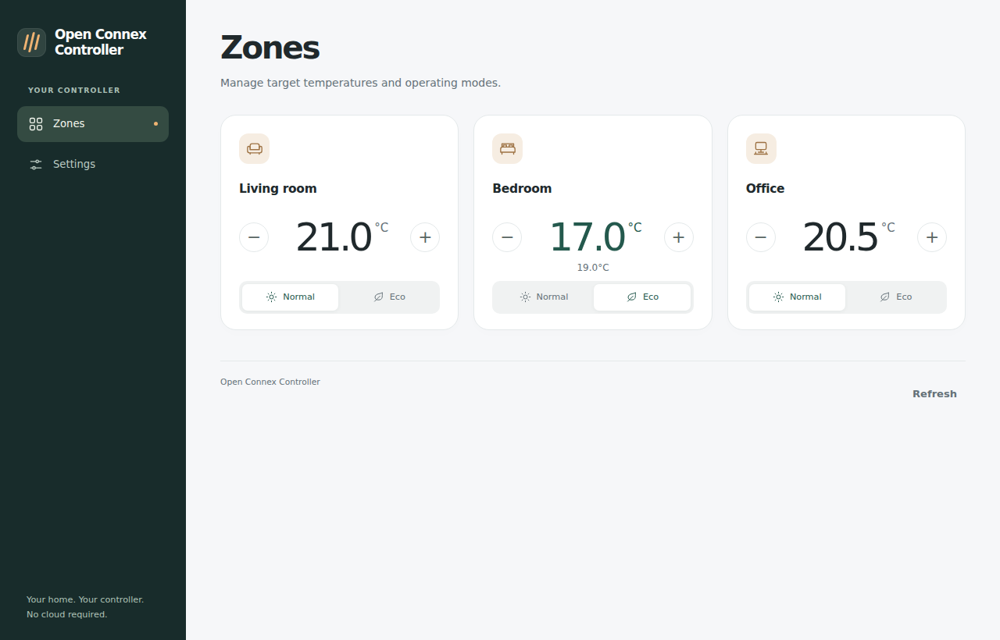
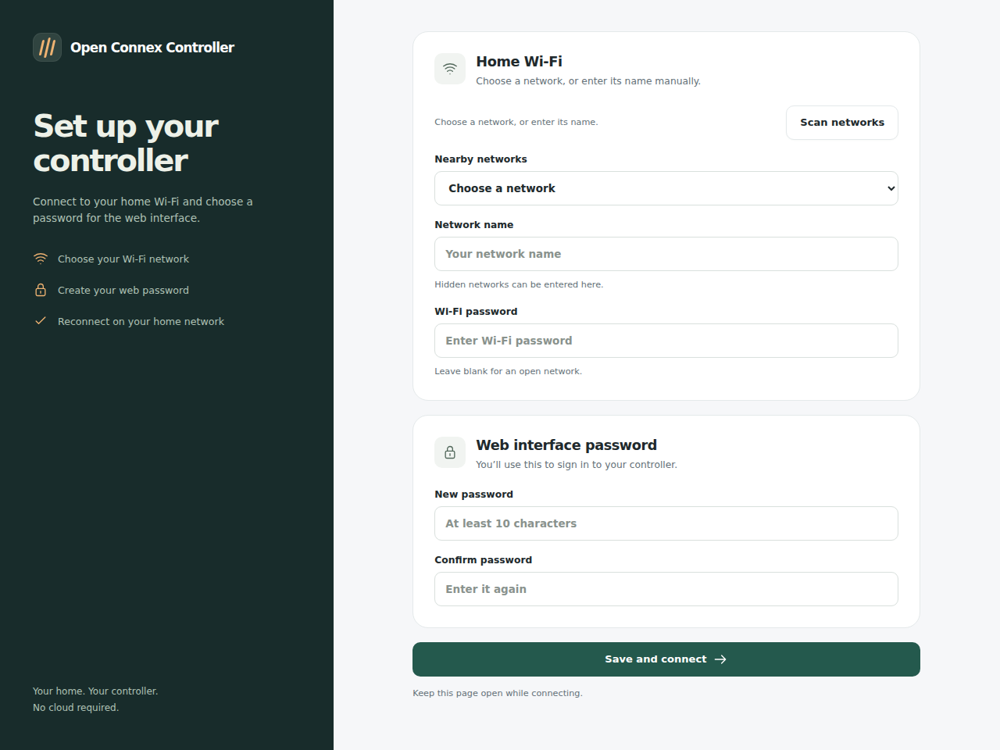
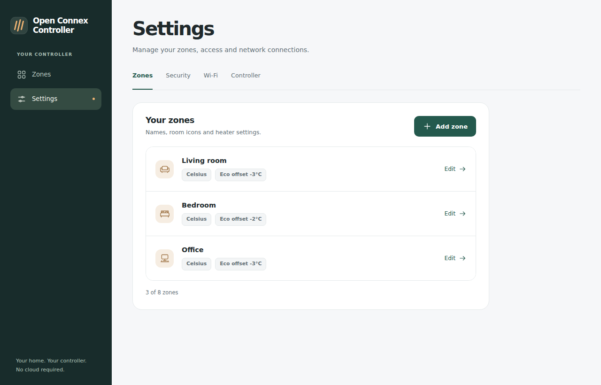

# Open Connex Controller

Open Connex Controller is a local substitute for **Dimplex Connex baseboard heater controllers**, such as the [Dimplex CX-MPC](https://www.dimplex.com/sites/g/files/emiian436/files/downloads/CX-MPC_Owners_Manual_1.pdf). It works with **Dimplex LPC-series Connex smart heaters**, letting you control them from your browser without a cloud account or subscription.

The controller runs on an **Arduino Nano ESP32** with an **nRF24L01+ radio** and connects to your home Wi-Fi.

- **Eight zones:** set temperatures, select Celsius or Fahrenheit, and switch between Normal and Eco.
- **Local web interface:** manage heaters, Wi-Fi, and access from a phone or desktop.
- **REST API:** connect your own scripts and home automations using an API token.
- **Standalone operation:** settings persist on the controller; no server or MQTT broker is required.

The dashboard shows requested settings. The heaters do not report room temperature or connectivity to the controller.

## Get started

### 1. Assemble and install

You need an Arduino Nano ESP32, an nRF24L01+ module supporting 250 kbit/s, a normally open pushbutton, a common-anode RGB status LED with current limiting, jumper wires, USB power, and a 2.4 GHz Wi-Fi network. Your heaters must support the [Connex radio protocol](doc/connex-protocol-spec.md).

Follow the [wiring and build guide](doc/firmware.md). The firmware source is `src/firmware/`, and the board target is `esp32:esp32:nano_nora`.

### 2. Connect to Wi-Fi

1. Power on the controller and join **OpenConnex-Setup-&lt;suffix&gt;** from your phone or computer.
2. Open the captive setup page, or visit **http://192.168.4.1/**.
3. Choose your home Wi-Fi network, enter its password, and choose a unique web password of 10–128 UTF-8 bytes.
4. After a successful connection, the setup hotspot closes after five seconds.
5. Rejoin your home network, open **http://open-connex.local/**, and sign in. If the name does not resolve, use the controller's IP address from your router.

### 3. Add a zone and pair heaters

1. Open **Settings → Zones → Add zone** and choose a name and room icon. New zones start at **20°C**, Normal mode, and zero Eco offset.
2. Put the heater into learning/pairing mode using its own controls.
3. Edit the zone, choose **Pair a heater**, then **Start pairing**.
4. Check the heater's display. After pairing finishes, change the zone temperature and verify that the heater follows.

Pairing runs for 30 seconds, sending the zone's settings immediately and every five seconds. Repeat for more heaters in the same zone, or create another zone for independent control. Check success on the heater; the countdown does not confirm pairing.

## Daily use

Adjust temperatures with the minus/plus buttons or enter a value directly. Normal mode uses the base target. Eco displays the base target plus the zone's Eco offset; editing that number adjusts the base target while keeping the offset.

Changes save immediately. After **10 seconds without another change to that zone**, the controller transmits the latest settings five times at one-second intervals. It also refreshes each zone once hourly after its latest send.

The status lights pulse **blue during setup**, show **green during normal connected operation**, and flash **red when Wi-Fi is disconnected or there is a fault**.

A short button press toggles **standby**, shown by solid red. Standby stops transmissions; heaters can continue heating to their last received setting. Press again to resume. A restart also resumes normal operation.

See the [web interface guide](doc/web-interface-spec.md) for zone settings, Wi-Fi changes, and access controls.

## Automations

Generate an API token in **Settings → Security**, then send requests to `http://open-connex.local/api/v1` with `Authorization: Bearer <token>`. The [REST API reference](doc/rest-api-spec.md) covers zones, temperature and mode changes, device health, and pairing.

## Recovery and security

- **Wi-Fi or password recovery:** hold the setup button for five seconds. This clears Wi-Fi credentials and the web password and reopens setup. Zones, radio identities, room icons, and the API token are retained.
- **Trusted networks only:** HTTP and the setup hotspot are unencrypted. Keep the controller off the public Internet and untrusted networks.
- **Deleting a zone:** removes its configuration from the controller. It does not switch off or unpair heaters.
- **Firmware upgrades:** use application-only uploads to preserve settings. See the [upgrade limits](doc/firmware.md#upgrades-and-storage).

## Reference and development

- [Firmware guide](doc/firmware.md) — hardware, build/upload, storage, security, and tests.
- [Web interface](doc/web-interface-spec.md) — setup, daily controls, and recovery.
- [REST API](doc/rest-api-spec.md) — endpoint contracts and examples.
- [Application protocol](doc/connex-protocol-spec.md) — payload fields, temperature encoding, modes, and pairing.
- [Radio framing](doc/connex-radio-framing.md) — radio configuration, packet framing, CRC, and acknowledgments.

Screenshots use the firmware's web interface with fictional example data.

## Acknowledgments

Built on the Connex work in [NorthernMan54/OpenNRF24L01](https://github.com/NorthernMan54/OpenNRF24L01). This is an independent project, not an official Dimplex product.
